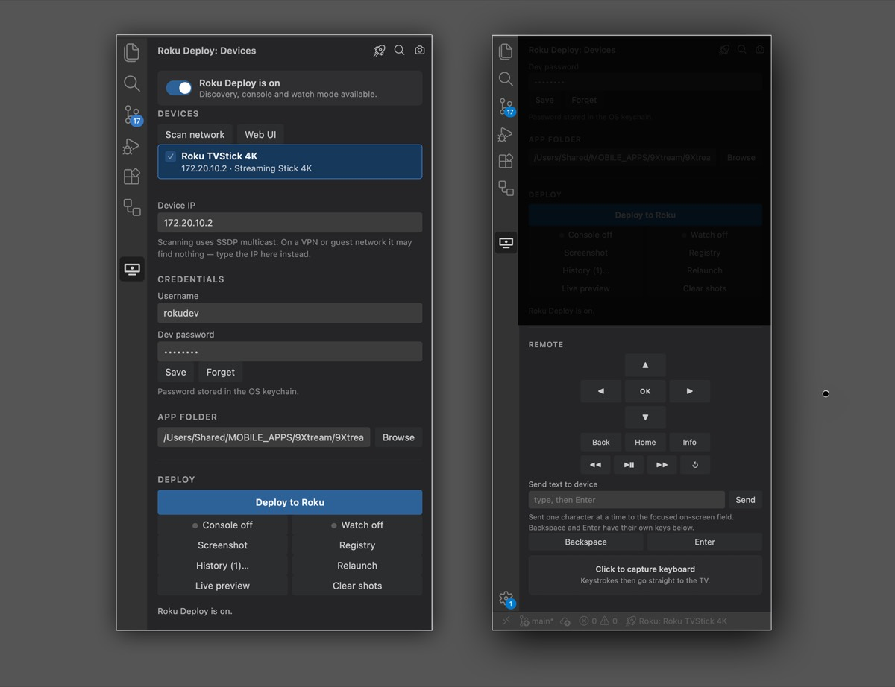
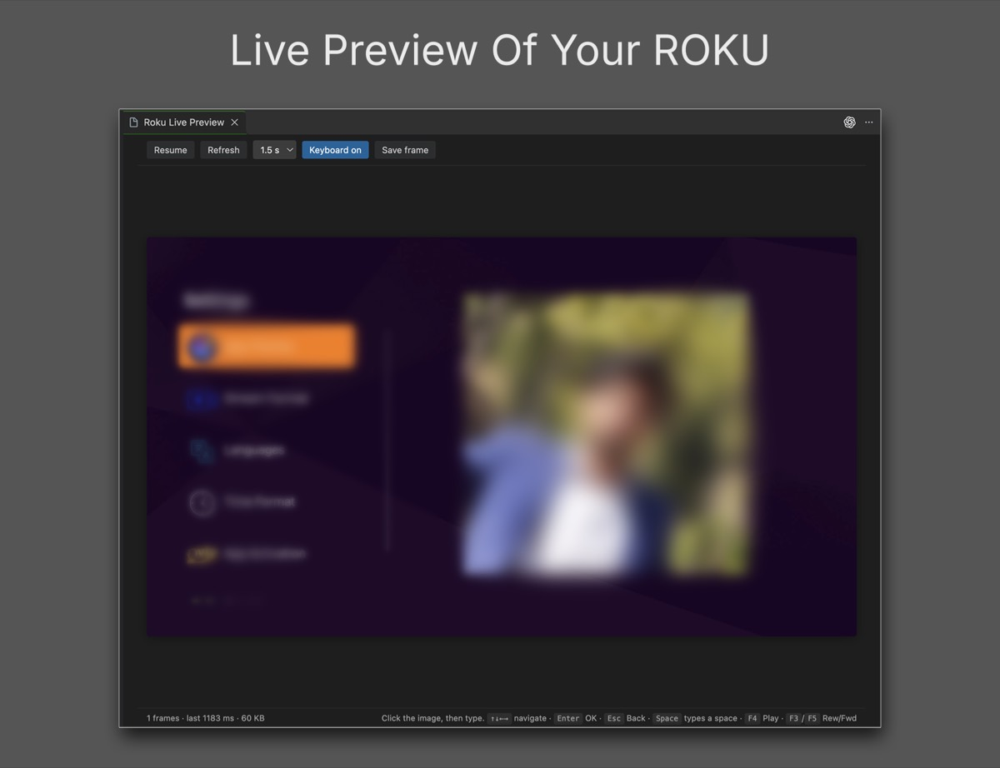

# Roku Studio

**Find your Roku, sideload your channel, and drive the TV, without leaving VS Code.**

Turn on **Live Preview** and **Keyboard Capture** together and you never touch the
remote, or even look at the TV. The screen is in an editor tab; your own keyboard
drives it. Deploy, navigate, type a URL and watch the result without your hands
leaving the keys or your eyes leaving the monitor.



---

## Everything in one panel

### Find any Roku on your network
Press **Scan network** and every Roku answers with its name, model, serial, and
whether developer mode is actually on, so you know before a deploy fails. On a VPN or
guest network where multicast is blocked, type the IP instead. Your choice is
remembered.

### Deploy in one click
Hit **Deploy to Roku** (or `Cmd+Alt+R`). The channel is packaged, the old build
removed and the new one installed, in seconds. Your developer password is kept
in the **OS keychain**, never in a script or a settings file you might commit.

### Errors land in the Problems panel
BrightScript compile errors come back from the device as HTML buried in an
install response. Roku Studio parses them and puts each one on **the exact file
and line** in the Problems panel. Click to jump straight to the broken code.
Runtime crashes streamed over the debug console are reported the same way, so a
`Type Mismatch` three screens deep still points at the line that threw it.

### Live debug console
The BrightScript console (port 8085) streams into an Output channel, and
reconnects by itself after every deploy, because the device drops the socket
when the channel restarts. All your `print` output, no telnet window.

---

## Live Preview: see your Roku inside VS Code



Watch the TV screen in an editor tab, refreshing about once a second. Then
**click the image and just type**: arrow keys navigate, `Enter` is OK, `Esc` is
Back, `Space` types a space, and `F3`–`F5` are Rewind, Play/Pause and Forward.

No second monitor, no craning round to see the TV, no hunting for the remote
under the sofa. The device is a window on your desktop.

**Paste a URL straight to the device.** Entering a long address with an
on-screen keyboard takes a minute. Here it takes one `Cmd+V`.

> Roku has no video-out API, so the preview is built from rapid screenshots and
> refreshes at roughly 1 fps. It is ideal for watching a layout change or
> confirming navigation; it is not a video stream.

---

## Put the remote down

A full **on-screen remote**, with D-pad, OK, Back, Home, Info and transport
controls, sits in the panel. Below it is the **keyboard capture pad**: click it
once and your own keyboard drives the TV. Every key is echoed back as you type,
so you can see exactly what was sent without glancing up.

**Together with Live Preview, the physical remote becomes unnecessary.** The
screen is in one tab, your keyboard is the remote, and the whole loop of deploy,
navigate, type and read the log happens on the monitor in front of you.

The capture pad polls nothing, so it costs no network traffic and works on any
screen, including during video playback.

---

## Built for a fast loop

| | |
|---|---|
| **Hot reload on save** | Turn on **Watch mode** and every save redeploys automatically. |
| **Relaunch** | Restart the dev channel instantly, without a full reinstall. |
| **Deploy history** | The last builds are kept. Roll any of them back onto the device in two clicks when a change breaks something. |
| **Screenshots** | Capture the screen to a file, opened right in the editor. Old captures prune themselves. |
| **Roku Web UI** | One button opens the device's own developer page in your browser. |
| **Multi-device deploy** | Tick several devices and push the same build to all of them at once. |
| **On/off switch** | Working on something else? Flip the switch and the extension goes completely idle, with no sockets, no timers and no watchers. It switches itself off in projects with no Roku manifest. |

Everything also lives behind `Cmd+Alt+K`, a command-palette overlay you can
reach without touching the sidebar.

---

## For AI agents: a built-in MCP server

Roku Studio ships a **Model Context Protocol server**, so any MCP client can
drive your Roku directly: deploy a build, read the crash log,
take a screenshot, press keys, type a URL. It talks to the device over the
network and **does not need VS Code running**.

Add it to your MCP client's config:

```json
{
  "mcpServers": {
    "roku": {
      "command": "node",
      "args": ["<extension-path>/out/mcp.js"],
      "env": {
        "ROKU_IP": "192.168.1.50",
        "ROKU_USER": "rokudev",
        "ROKU_PASS": "your-dev-password",
        "ROKU_APP_DIR": "/path/to/your/app/root"
      }
    }
  }
}
```

Nine tools: `rokustudio_scan`, `rokustudio_device_info`, `rokustudio_deploy`, `rokustudio_screenshot`,
`rokustudio_keypress`, `rokustudio_type`, `rokustudio_launch`, `rokustudio_console`, `rokustudio_registry`.

Screenshots come back downscaled to 500px and recompressed, a few KB instead of
130 KB, so an agent can look at the screen cheaply. Pass `maxPx: 0` for the
full 1920×1080 frame.

---

## Getting started

1. Enable developer mode on your Roku (`Home ×3, Up ×2, Right, Left, Right, Left, Right`)
   and set a password.
2. Open your channel project in VS Code and click the Roku icon in the activity bar.
3. **Scan network**, pick your device, enter the password once, press **Deploy**.

## Shortcuts

| Shortcut | Action |
| --- | --- |
| `Cmd+Alt+R` | Deploy |
| `Cmd+Alt+K` | Quick actions overlay |
| `Cmd+Alt+J` | Remote control |
| `Cmd+Alt+L` | Live preview |

(`Ctrl` instead of `Cmd` on Windows and Linux.)

## Settings

| Setting | Default | Meaning |
| --- | --- | --- |
| `rokuStudio.appDir` | `root` | Folder holding the manifest |
| `rokuStudio.bumpManifest` | `true` | Ensure each package differs from the last |
| `rokuStudio.bumpBuildVersion` | `false` | Also increment `build_version` each deploy |
| `rokuStudio.autoReconnectConsole` | `true` | Reconnect the console after a deploy |
| `rokuStudio.scanTimeoutMs` | `4000` | How long to listen for SSDP replies |
| `rokuStudio.watchDebounceMs` | `1200` | Quiet period before an automatic redeploy |
| `rokuStudio.historyLimit` | `5` | Retained packages for rollback |
| `rokuStudio.screenshotLimit` | `50` | Screenshots kept when pruning |
| `rokuStudio.screenshotAutoPrune` | `true` | Delete the oldest beyond the limit |
| `rokuStudio.liveViewIntervalMs` | `1500` | Live preview capture interval |

## Good to know

- **Screenshots and live preview need the channel running.** Capturing from the
  Roku home screen returns "Screenshot not ok", so press **Relaunch** first.
- **The debug console allows one connection.** Port 8085 accepts a single
  client, so the console and an external telnet session cannot both hold it.
- **The registry is not exposed on every firmware.** Some devices return nothing
  for a registry request; the extension tells you rather than showing a blank page.

## License

MIT
